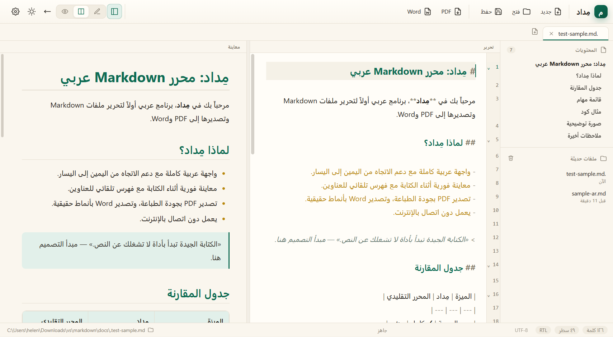
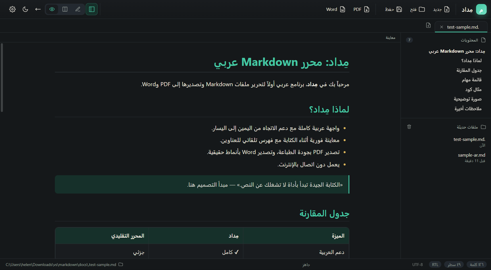
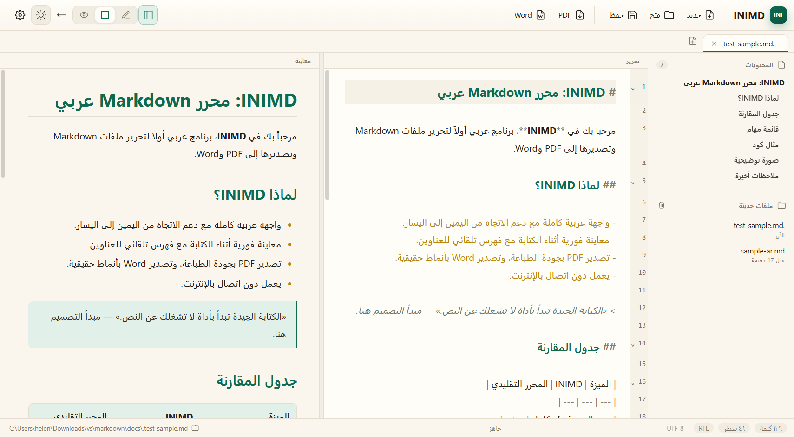
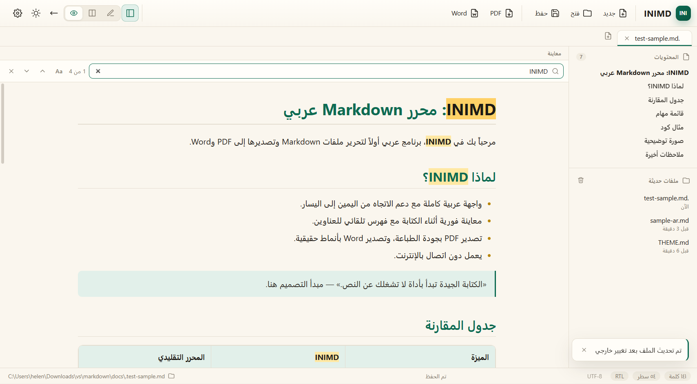
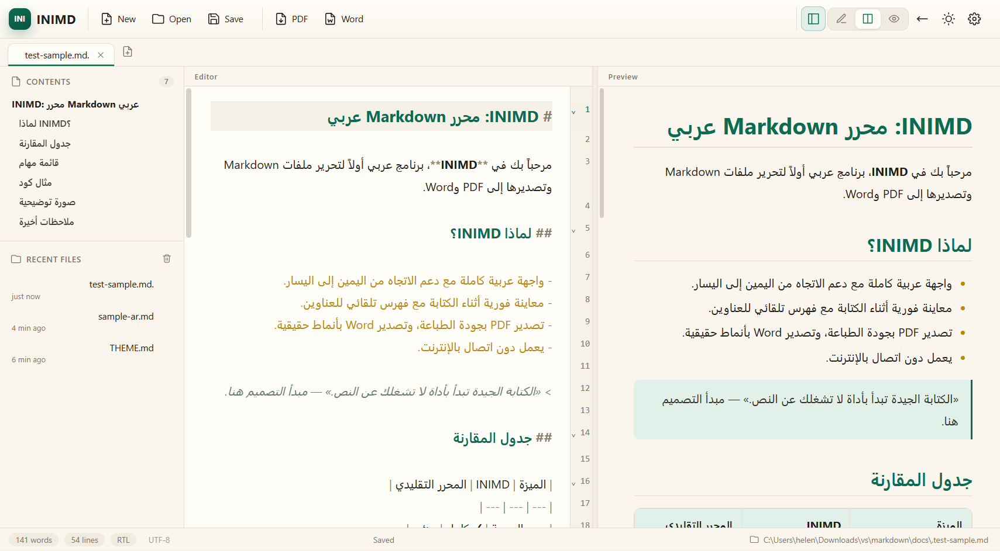
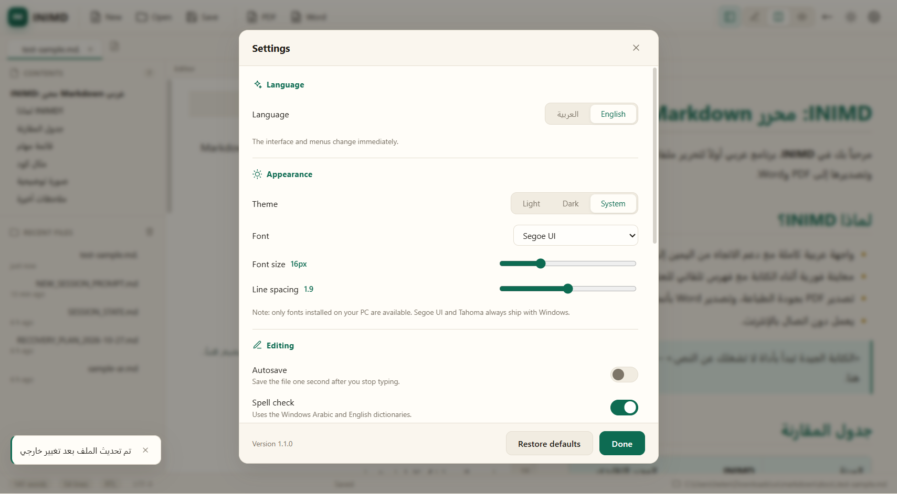
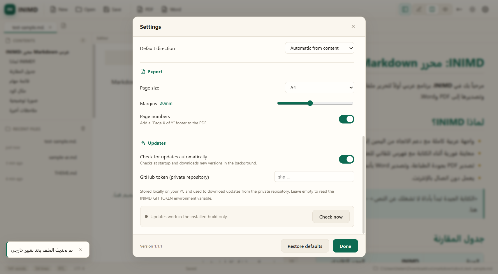
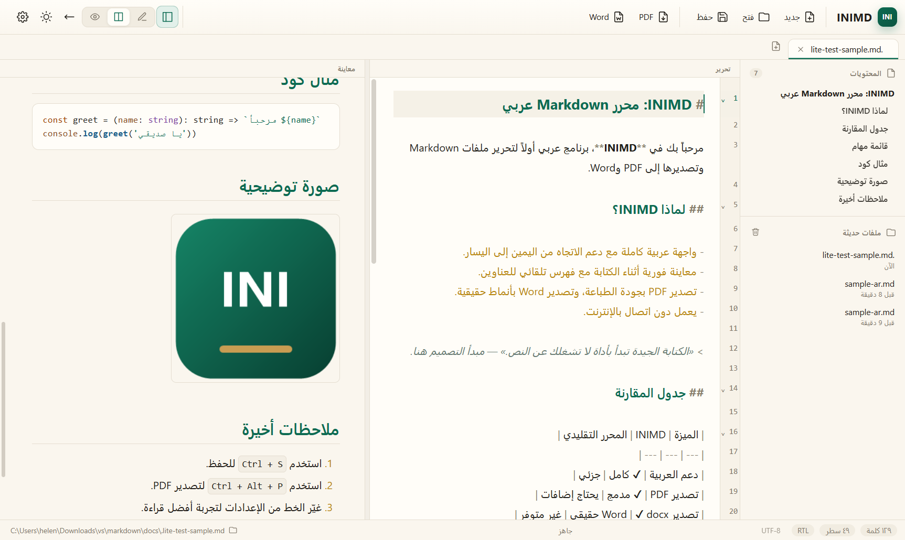

# INIMD — محرر Markdown عربي لويندوز

**INIMD** برنامج سطح مكتب خفيف وعربي أولاً لفتح ملفات Markdown وتحريرها ومعاينتها، مع تصدير مباشر إلى **PDF** و**Word (docx)** بدون إنترنت وبدون أي برامج خارجية.

> **تطوير:** INI — للتواصل: [ibrahim.noshy@hotmail.com](mailto:ibrahim.noshy@hotmail.com)


## التنزيل

أحدث إصدار جاهز للتثبيت: [github.com/inisoliman/INIMD/releases](https://github.com/inisoliman/INIMD/releases/latest)

**النسخة الكاملة (Electron — موصى بها):**

- `INIMD-Setup-1.1.1.exe` — مثبّت NSIS (**109.8 MB**، للمستخدم الحالي، بدون صلاحيات مدير).
- `INIMD-Portable-1.1.1.exe` — نسخة محمولة (**99.5 MB**) لا تحتاج تركيب.

**النسخة الخفيفة (INIMD Lite — للإنترنت الضعيف والأجهزة القديمة):**

- [`INIMD.Lite_1.0.0_x64-setup.exe`](https://github.com/inisoliman/INIMD/releases/download/lite-v1.0.0/INIMD.Lite_1.0.0_x64-setup.exe) — مثبّت بحجم **~3.5 MB**، منشور كإصدار تجريبي بوسم `lite-v1.0.0`.

## المزايا

- **واجهة عربية وإنجليزية**: تبديل اللغة من الإعدادات (أو `Ctrl + ,`) يغيّر الواجهة والقوائم والحوارات ورسائل التصدير فوراً، مع حفظ الاختيار.
- **ربط تلقائي بملفات `.md` و`.markdown`** عند التركيب: نقرة مزدوجة من مستكشف ويندوز تفتح الملف في INIMD، مع عنصر «فتح بواسطة».
- **دعم عربي كامل**: كشف اتجاه تلقائي (RTL/LTR)، تبديل يدوي لكل ملف، خطوط عربية، تباعد أسطر مريح، وعزل ثنائي الاتجاه للأكواد والروابط.
- **تحرير ومعاينة**: عرض مقسوم بمزامنة تمرير، أو تحرير فقط، أو معاينة فقط، مع فهرس عناوين جانبي وقائمة ملفات حديثة.
- **بحث داخل المعاينة**: `Ctrl + F` في وضع المعاينة (أو في العرض المقسوم دون التركيز على المحرر) يفتح شريط بحث يظلّل كل المطابقات ويقفز بينها مع عدّاد، دون إعادة توليد الصفحة.
- **محرر CodeMirror 6**: تمييز صياغة Markdown، إكمال تلقائي، بحث واستبدال بواجهة عربية أو إنجليزية، حزم كود، تراجع/إعادة.
- **تصدير PDF**: بجودة الطباعة، مقاسات A4/Letter، هوامش قابلة للضبط، أرقام صفحات اختيارية، جداول وصور ونص عربي متصل.
- **تصدير Word**: ملف `.docx` حقيقي بأنماط عناوين وجداول وقوائم، مع ضبط اتجاه RTL وخصائص `w:rtl` للنصوص العربية.
- **تحديث تلقائي من GitHub**: يفحص البرنامج الإصدارات الجديدة عند الإقلاع (قابل للتعطيل)، ويُظهر شريط إشعار عند توفّر تحديث مع زر تنزيل وتثبيت وإعادة تشغيل.
- **متابعة الملف على القرص**: إذا عُدّل الملف المحفوظ من محرر آخر يُعيد INIMD تحميله تلقائياً، وإن كانت لديك تغييرات غير محفوظة يسألك قبل الاستبدال.
- **حفظ تلقائي** اختياري، وتنبيه التغييرات غير المحفوظة قبل الإغلاق.
- **ثيمات**: فاتح/داكن/تلقائي، وأحجام خطوط قابلة للضبط.
- **أمان**: عزل سياق (`contextIsolation`)، sandbox، تعطيل `nodeIntegration`، وتنقية HTML الناتج عبر DOMPurify.
- يعمل **دون اتصال بالإنترنت** بالكامل (الإنترنت مطلوب فقط لفحص التحديثات).

## النسخة الخفيفة: INIMD Lite

نسخة ثانية من البرنامج مبنية على **Tauri 2 + WebView2** بواجهة React نفسها، موجهة لمن لديه **إنترنت ضعيف** أو قرص صغير أو جهاز قديم. صدرت كإصدار تجريبي بوسم `lite-v1.0.0` ولا تؤثر إطلاقاً على النسخة الكاملة المنشورة.

| المقارنة | INIMD (Electron) | INIMD Lite (Tauri) |
| --- | --- | --- |
| حجم المثبّت | ~109.8 MB | **~3.5 MB** |
| الحجم على القرص | ~324 MB | **~4 MB** |
| الذاكرة عند التشغيل | أعلى | **أقل بكثير** |
| المعاينة والتحرير والبحث `Ctrl+F` | ✅ | ✅ |
| تصدير Word (docx) | ✅ | ✅ |
| تصدير PDF | مدمج عبر `printToPDF` | عبر Edge/Chrome headless (متوفّر في ويندوز 10/11) |
| واجهة عربية/إنجليزية، RTL، ثيمات | ✅ | ✅ |
| متابعة الملف على القرص | ✅ | ✅ (مراقبة دورية) |
| ربط ملفات `.md` | ✅ | ✅ |
| التحديث التلقائي | نعم (تثبيت صامت) | فحص التحديثات فقط — التنزيل يدوي |
| قائمة «أدوات المطور» | ✅ | ✖ |

**القيود:** تصدير PDF يحتاج توفر **Microsoft Edge** (أو Chrome) على الجهاز، والتحديثات لا تُثبّت نفسها بل تُنبّهك إلى إصدار جديد. تحتاج النسخة الخفيفة توفر **WebView2 Runtime** (موجود افتراضياً في ويندوز 11 وحديث ويندوز 10).

## لقطات

| الواجهة | المعاينة العربية |
| --- | --- |
|  |  |

| الوضع الداكن | بحث المعاينة (`Ctrl + F`) |
| --- | --- |
|  |  |

| الواجهة الإنجليزية | إعدادات اللغة والتحديثات |
| --- | --- |
|  |  |

| التحديثات والتوكن | النسخة الخفيفة INIMD Lite |
| --- | --- |
|  |  |

## نماذج المخرجات

مخرجات حقيقية وُلّدت من [`docs/sample-ar.md`](docs/sample-ar.md):

- [`docs/samples/inimd-sample.pdf`](docs/samples/inimd-sample.pdf) — صفحتان بترقيم صفحات وجدول وصورة.
- [`docs/samples/inimd-sample.docx`](docs/samples/inimd-sample.docx) — مستند Word باتجاه RTL وأنماط عناوين.

## التشغيل للتطوير

المتطلبات: ويندوز 10/11، Node.js 20 أو أحدث.

```bash
npm install
npm run dev
```

## البناء والتوزيع

```bash
# بناء ملفات التطبيق
npm run build

# فحص الأنواع
npm run typecheck

# اختبار آلي خاطف (يولّد PDF وWord في مجلد مؤقت)
npm run selftest

# اختبار واجهة كامل عبر Playwright: فتح ملف عربي، تحرير، حفظ، بحث المعاينة، تبديل اللغة، تصدير PDF وWord
npm run check:ui

# التحقق من نسخة التثبيت المبنية في release/win-unpacked
npm run check:packaged

# التحقق من نظام التحديث في النسخة المبنية (يتصل بـ GitHub)
npm run check:update

# إعادة توليد نماذج المخرجات في docs/samples
npm run sample:export

# مثبّت NSIS للمستخدم الحالي (بدون صلاحيات مدير)
npm run dist

# نسخة محمولة (بدون تركيب)
npm run dist:portable
```

بناء النسخة الخفيفة (INIMD Lite) يحتاج إضافة **Rust** و**MSVC Build Tools** إلى جانب Node.js:

```bash
npm --prefix lite install      # مرة واحدة
npm run lite:dist              # Vite + cargo release + مثبّت NSIS
npm run check:lite             # اختبار دخاني آلي على النسخة المبنية
```

تجد مخرجات Lite في `lite/src-tauri/target/release/bundle/nsis/`.

تجد مخرجات Electron في مجلد `release/`:

- `INIMD-Setup-1.1.1.exe` — مثبّت عادي يسجّل ربط ملفات `.md`.
- `INIMD-Portable-1.1.1.exe` — نسخة محمولة.
- `latest.yml` — بيانات التحديث التي يقرأها `electron-updater`.

> **ربط ملفات `.md`:** يسجّل المثبّت INIMD كبرنامج لفتح ملفات Markdown، لكن ويندوز 10/11 قد يحتفظ بالبرنامج الافتراضي السابق. لتثبيته افتراضياً: انقر بالزر الأيمن على أي ملف `.md` ← **فتح باستخدام** ← **اختيار تطبيق آخر** ← اختر **INIMD** ← **دائماً**.

## التحديثات

يفحص INIMD التحديثات عند الإقلاع افتراضياً، ويمكن تعطيل ذلك من **الإعدادات ← التحديثات** أو الضغط على **تحقق الآن**.

بما أن المستودع **خاص (private)**، يحتاج فحص التحديثات إلى توكن GitHub بصلاحية `repo`:

1. أنشئ توكن Personal Access Token من [github.com/settings/tokens](https://github.com/settings/tokens).
2. الصقه في **الإعدادات ← التحديثات ← توكن GitHub** (يُحفظ محلياً على جهازك فقط).
3. بديلاً، عيّن متغير البيئة `INIMD_GH_TOKEN` أو `GH_TOKEN` قبل تشغيل البرنامج.

الملفات التي يحتاجها التحديث في كل إصدار: `latest.yml` مع المثبّت `INIMD-Setup-x.y.z.exe` (و ملف `.blockmap` إن وُجد). انشرها مع الإصدار على GitHub حتى يعمل التحديث التلقائي.

### ملاحظة حول SmartScreen

النسخة غير موقّعة رقمياً، لذا قد يعرض ويندوز تحذير «Windows protected your PC» عند أول تشغيل. اختر **More info → Run anyway**. لإزالة التحذير يلزم شهادة توقيع كود.

## الاختصارات

| الاختصار | الوظيفة |
| --- | --- |
| `Ctrl + N` | ملف جديد |
| `Ctrl + O` | فتح ملف |
| `Ctrl + S` | حفظ |
| `Ctrl + Shift + S` | حفظ باسم |
| `Ctrl + W` | إغلاق التبويب |
| `Ctrl + F` | بحث في المعاينة (وضع المعاينة) أو بحث/استبدال في المحرر |
| `Ctrl + B` | الشريط الجانبي |
| `Ctrl + Shift + V` | تبديل المعاينة |
| `Ctrl + Alt + P` | تصدير PDF |
| `Ctrl + Alt + W` | تصدير Word |
| `Ctrl + ,` | الإعدادات |

## بنية المشروع

```
src/
  main/            عملية Electron الرئيسية
    index.ts       النافذة، القائمة، IPC، ربط الملفات، بروتوكول الصور، مراقبة الملفات
    docx-env.ts    بيئة توليد docx داخل Node (Packer.toBuffer + fs)
    pdf.ts         تصدير PDF عبر printToPDF
    files.ts       قراءة الملفات وترميزاتها
    store.ts       الإعدادات والملفات الحديثة
    updater.ts     فحص التحديثات والتنزيل والتثبيت عبر electron-updater
  preload/         جسر آمن (contextBridge)
  renderer/        واجهة React
    src/
      components/  الواجهة: المحرر، المعاينة، البحث، التبويبات، الإعدادات…
      lib/         markdown، print، find، i18n، المسارات، الإحصاءات
      styles/      CSS
  shared/          أنواع مشتركة وقاموس الترجمة
    docx.ts        محوّل Markdown → docx المشترك بين Electron وLite
    types.ts       واجهة window.api والأنواع
    i18n.ts        قاموس ar/en
lite/              النسخة الخفيفة (Tauri + WebView2)
  src/             جسر window.api لأوامر Rust + نقطة الدخول (تعيد استخدام واجهة React نفسها)
  src-tauri/       خلفية Rust: الأوامر، القائمة الأصلية، مراقبة الملفات، تصدير PDF عبر Edge
  scripts/         smoke.mjs — اختبار آلي عبر Playwright/CDP
build/             الأيقونات وإعدادات المثبّت
scripts/           توليد الأيقونات والاختبارات الآلية
```

## التقنيات

**INIMD:** Electron · electron-vite · React 19 · TypeScript · CodeMirror 6 · markdown-it · highlight.js · DOMPurify · docx · electron-builder

**INIMD Lite:** Tauri 2 · WebView2 · Rust · React 19 · TypeScript · CodeMirror 6 · docx (في المتصفح)

## النشر على GitHub

المستودع خاص (private) باسم `INIMD` على حساب `inisoliman`:
<https://github.com/inisoliman/INIMD>

الإصدار `v1.1.1` هو الإصدار الحالي للنسخة الكاملة، ويضم المثبّت والنسخة المحمولة و`latest.yml` لأجل التحديث التلقائي. إصدارات النسخة الخفيفة تُنشر منفصلة بوسم `lite-v*` وكـ **prerelease** حتى لا تزاحم `latest` الذي يقرأه `electron-updater`. لتحديث النسخة من جهاز آخر:

```bash
gh auth login
git push origin main
```

ولإصدار جديد (على اتصال بطيء، أنشئ الإصدار كمسودة ثم ارفع الأصول ملفًا ملفًا):

```bash
# 1) مسودة فارغة (لا تُنشَر حتى تنتهي كل الأصول)
gh release create v1.1.1 --draft --title "INIMD 1.1.1" --notes "ملاحظات الإصدار."

# 2) الرفع منفصلًا مع إعادة المحاولة عند انقطاع الاتصال
gh release upload v1.1.1 "release/latest.yml" "release/INIMD-Setup-1.1.1.exe.blockmap" --clobber
gh release upload v1.1.1 "release/INIMD-Setup-1.1.1.exe" --clobber
gh release upload v1.1.1 "release/INIMD-Portable-1.1.1.exe" --clobber

# 3) النشر كـ Latest بعد التحقق من الأصول
gh release edit v1.1.1 --draft=false --latest

# النسخة الخفيفة (prerelease، لا تلمس latest)
gh release create lite-v1.0.0 "lite/src-tauri/target/release/bundle/nsis/INIMD Lite_1.0.0_x64-setup.exe" --prerelease --title "INIMD Lite 1.0.0" --notes "نسخة خفيفة تجريبية."
```

> إن رفعت كل الملفات في أمر `gh release create` واحد على اتصال بطيء فقد يفشل بـ `HTTP 408: Upload body timed out`. الطريقة أعلاه تتجنّب ذلك.

> يرفع GitHub الأصول ويستبدل المسافات في أسماء الملفات بنقاط، فيصبح الأصل `INIMD.Lite_1.0.0_x64-setup.exe`.

> إن كان المستودع خاصاً، أضف التوكن إلى الإعدادات (أو `INIMD_GH_TOKEN`) كما في قسم **التحديثات** أعلاه.

## English

INIMD is a lightweight, Arabic-first Markdown desktop editor for Windows by **INI** (contact: [ibrahim.noshy@hotmail.com](mailto:ibrahim.noshy@hotmail.com)). It offers a bilingual Arabic/English interface, RTL/LTR auto-direction, split preview with synced scrolling, in-preview find (`Ctrl + F`), offline PDF and Word export, optional autosave, reload on external file changes, and GitHub-based auto-update. Install per-user (no admin rights) from the [latest release](https://github.com/inisoliman/INIMD/releases/latest); the repository is private, so update checks need a `repo` GitHub token in **Settings → Updates**.

An ultra-light **INIMD Lite** build (Tauri 2 + WebView2, ~3.5 MB installer) reuses the same React UI for slow connections and older machines. It is published as a prerelease under the `lite-v*` tag so it never shadows the `latest` release used by the updater. Lite exports PDF via headless Edge/Chrome and can only check for updates (downloads are manual).

## تطوير

طُوِّر بواسطة **INI**.

- البريد: [ibrahim.noshy@hotmail.com](mailto:ibrahim.noshy@hotmail.com)

## الترخيص

MIT — راجع ملف [LICENSE](LICENSE).

